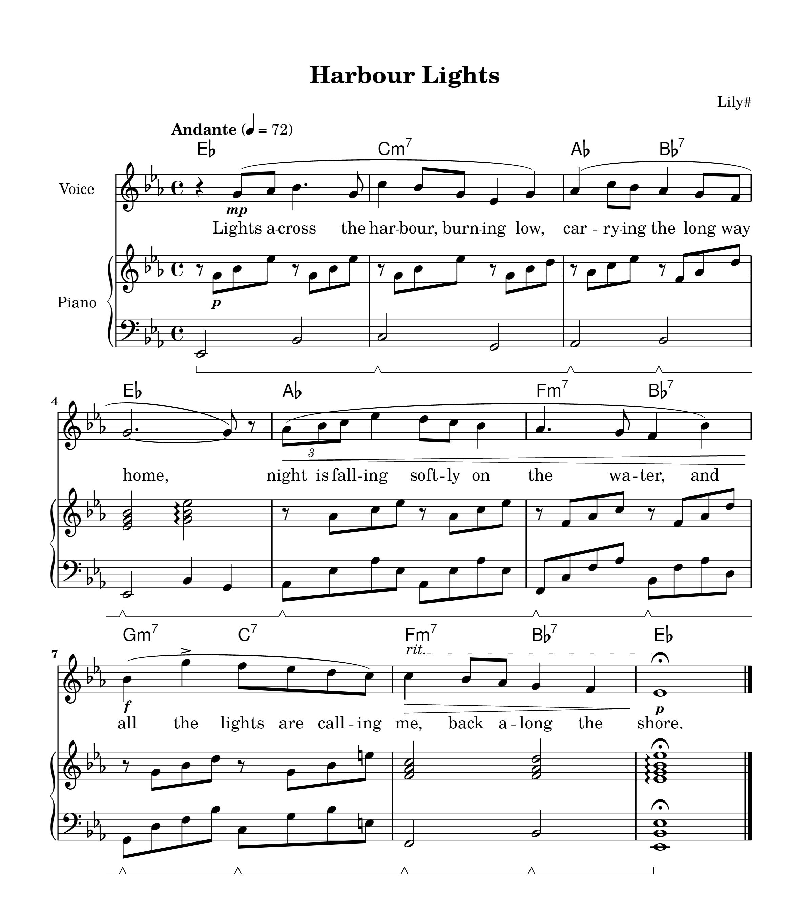
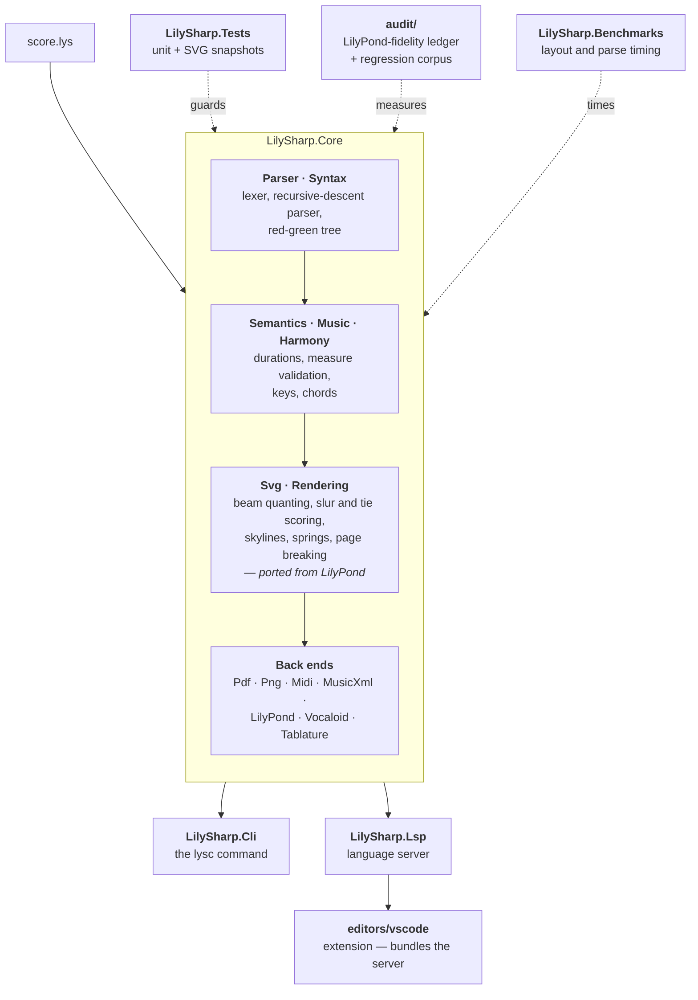

# Lily#

A music notation language and engraving engine — publication-quality sheet music
from plain text, with an IDE-first toolchain.

**Website: [yotsuda.github.io/LilySharp](https://yotsuda.github.io/LilySharp/)** — the
editor at work, a gallery of engraved scores, and the
[language manual](https://yotsuda.github.io/LilySharp/grammar.html).

[](https://github.com/yotsuda/LilySharp/actions/workflows/ci.yml)
[](https://marketplace.visualstudio.com/items?itemName=yotsuda.lilysharp)
[](LICENSE)

<p align="center">
  
</p>

The same page playing, with each note lit as it sounds — the way the VS Code preview follows along:

https://github.com/user-attachments/assets/4483b787-1d2d-4f43-b3b7-09782aff3a47

That page is the whole of [`samples/harbour-lights.lys`](samples/harbour-lights.lys):

<!-- README-SAMPLE:harbour-lights (kept identical to the file by ReadmeSampleTests) -->
```lilysharp
// Harbour Lights — an original song written for the Lily# README.
//
// One page from one source: chord symbols, a voice with its lyrics, and a piano on a
// grand staff — pedal changes, hairpins, a triplet, a ritardando, rolled chords and
// fermatas. Written in absolute octaves: bare c is C4 (C3 in the left hand).
title "Harbour Lights"
composer "Lily#"
tempo "Andante" 4 = 72
time 4/4
key ees major
octave absolute

part singer "Voice" { clef treble }
part rh "Piano" { clef treble }
part lh { clef bass octave 3 }

section Song {
  chords harmony { Eb | Cm7 | Ab Bb7 | Eb | Ab | Fm7 Bb7 | Gm7 C7 | Fm7 Bb7 | Eb | }
  singer {
    r4 g8@mp@phrasingSlur aes bes4. g8 | c'4 bes8 g ees4 g@!phrasingSlur |
    aes4@phrasingSlur c'8 bes aes4 g8 f | g2.~ g8@!phrasingSlur r |
    tuplet 3/2 { aes8@cresc@phrasingSlur bes c' } ees'4 d'8 c' bes4 | aes4. g8 f4 bes@!phrasingSlur |
    bes4@f@phrasingSlur g'@accent f'8 ees' d' c'@!phrasingSlur | c'4@rit@decresc bes8 aes g4 f |
    ees1@p@fermata@!rit |.
  }
  lyrics words sings singer {
    Lights a- cross the | har- bour, burn- ing low, |
    car- ry- ing the long way | home, |
    night is fall- ing soft- ly on | the wa- ter, and |
    all the lights are call- ing | me, back a- long the | shore. |
  }
  rh {
    r8 g@p bes ees' r g bes ees' | r8 g bes ees' r g bes d' |
    r8 aes c' ees' r f aes d' | <ees g bes>2 <g bes ees'>2@arpeggio |
    r8 aes c' ees' r aes c' ees' | r8 f aes c' r f aes d' |
    r8 g bes d' r g bes e' | <f aes c'>2 <f aes d'>2 |
    <ees g bes ees'>1@arpeggio@fermata |.
  }
  lh {
    ees,2@sustain bes, | c2@sustain g, |
    aes,2@sustain bes,@sustain | ees,2@sustain bes,4 g, |
    aes,8@sustain ees aes ees aes, ees aes ees | f,8@sustain c f aes bes,@sustain f aes d |
    g,8@sustain d f bes c@sustain g bes e | f,2@sustain bes,@sustain |
    <ees, bes, ees>1@fermata@!sustain |.
  }
}

form { ~Song }

score {
  chords harmony
  staff singer
  lyrics words
  grandStaff {
    staff rh
    staff lh
  }
}
```

## Documentation

Everything about writing music in Lily# lives on the website:

| Page | What it covers |
|------|----------------|
| [Get started](https://yotsuda.github.io/LilySharp/start.html) | Install the extension, write a first score and hear it — in a few minutes |
| [Learn](https://yotsuda.github.io/LilySharp/learn.html) | Twelve short lessons that open in VS Code |
| [Language reference](https://yotsuda.github.io/LilySharp/grammar.html) | Every construct of the language, with engraved examples: [writing music](https://yotsuda.github.io/LilySharp/ref-music.html), [structure](https://yotsuda.github.io/LilySharp/ref-structure.html), [output](https://yotsuda.github.io/LilySharp/ref-output.html), [look-up tables](https://yotsuda.github.io/LilySharp/ref-lookup.html) |
| [Chords](https://yotsuda.github.io/LilySharp/chords.html) | Chord names, guitar chord diagrams and chords written from a shape |
| [The editor and AI](https://yotsuda.github.io/LilySharp/editor.html) | Live preview, typing aids, audition, settings and the AI features |
| [Editor commands](https://yotsuda.github.io/LilySharp/commands.html) | Every command in VS Code's menus and palette |
| [About](https://yotsuda.github.io/LilySharp/about.html) | What Lily# owes LilyPond, its licence and fonts, and how it is put together |

In this repository, [`docs/GRAMMAR_FOR_LLM.md`](docs/GRAMMAR_FOR_LLM.md) is the language in one
file (the copy an AI assistant reads), [`docs/GRAMMAR.md`](docs/GRAMMAR.md) the formal grammar,
and [`docs/CLI_REFERENCE.md`](docs/CLI_REFERENCE.md) the `lysc` command line.
[CHANGELOG.md](CHANGELOG.md) records what changed between releases.

## Overview

Lily# compiles a `.lys` source file to engraved sheet music (SVG, PDF, PNG), and to MIDI,
MusicXML, LilyPond source and VOCALOID sequences. It engraves staff notation, guitar
tablature and staff-less lead sheets from the same source.

Its layout engine is in part a **port of LilyPond**, the GNU music typesetter — see
[Relationship to LilyPond](#relationship-to-lilypond). The language, by contrast, is
deliberately not LilyPond's: it is written to be read, to be completed by an editor as you
type, and to be recompiled incrementally on every keystroke.

## Install

### VS Code extension (recommended)

Open the Extensions view (`Ctrl+Shift+X` / `Cmd+Shift+X`), search for **Lily#**, and
click **Install** on the one by *yotsuda* — or install it from its
[Marketplace listing](https://marketplace.visualstudio.com/items?itemName=yotsuda.lilysharp).
Then open any `.lys` file: you get diagnostics as you type, completion, and a live
score preview beside the source.

Nothing else to install — each platform's package bundles its own .NET runtime, and
VS Code picks the one for your machine. See
[editors/vscode/README.md](editors/vscode/README.md) for settings and troubleshooting.

### CLI (`lysc`)

Only needed for batch work and scripting — the extension does not require it.
Download the archive for your platform from
[Releases](https://github.com/yotsuda/LilySharp/releases), unpack it, and put `lysc`
on your `PATH`. Self-contained as well: the runtime and the fonts ship inside.

## Usage

```bash
lysc svg samples/fur-elise.lys          # engrave -> fur-elise.svg
lysc pdf samples/greensleeves.lys       # -> greensleeves.pdf
lysc midi samples/canon-in-d.lys        # -> canon-in-d.mid
lysc check samples/drunken-sailor.lys   # syntax check only, no output file
lysc --help                             # every command; lysc svg --help for one
```

| Command | Output |
|---------|--------|
| `svg` `pdf` `png` | Engraved sheet music |
| `midi` | MIDI, with dynamics and articulations |
| `xml` | MusicXML |
| `ly` | LilyPond source |
| `vsqx` | VOCALOID sequence (vocal part + lyrics) |
| `boxes` | Every drawn symbol's box as JSON (training data for score readers) |
| `import` | MusicXML → Lily# source |
| `octave` | Rewrites a file into absolute or relative octaves |
| `harmonize` | Suggests a diatonic chord track for a melody |
| `check` | Syntax check, no output |
| `layout` | Text summary of system and line breaks |

[`samples/`](samples/) holds five complete public-domain pieces, three short originals and a
two-bar beaming demo — see [samples/README.md](samples/README.md) for what each one shows.

## Project Structure

One library does the work; everything else is a front end onto it or a net under it.



The engraving engine is `LilySharp.Core/Svg/` and `LilySharp.Core/Rendering/` — that is
where the LilyPond port lives, and where most of the code is.

Alongside the code:

| Path | What it holds |
|------|---------------|
| [`samples/`](samples/) | Complete pieces — see [samples/README.md](samples/README.md) |
| [`site/`](site/) | The website: its pages, examples and lessons, built by `site/build-site.ps1` |
| [`docs/`](docs/) | The grammar in its source forms, and the design notes behind the engine |
| [`audit/`](audit/) | The LilyPond-fidelity ledger and the regression corpus |

## Building from source

### Requirements

- .NET 10 SDK
- Node.js (for the VS Code extension)

### Build

```bash
dotnet build LilySharp.slnx
dotnet test  LilySharp.Tests/LilySharp.Tests.csproj
```

Run the CLI without installing it:

```bash
dotnet run --project LilySharp.Cli -- svg samples/fur-elise.lys
```

### Run the LSP server

```bash
dotnet run --project LilySharp.Lsp
```

### Build the VS Code extension

```bash
cd editors/vscode
npm install
npm run compile
```

## Relationship to LilyPond

Lily# is an independent project. It is **not** affiliated with, endorsed by, or a
release of the LilyPond project, and its language is deliberately not LilyPond's.

Its engraving engine, however, is in part a **port of LilyPond**, the GNU music
typesetter: beam quanting, slur and tie scoring, skylines, springs, page breaking
and other layout algorithms are modified translations of LilyPond's C++ and Scheme
rather than independent implementations. Those files carry the copyright notices of
the LilyPond files they were ported from, and
[LILYPOND-ATTRIBUTION.md](LILYPOND-ATTRIBUTION.md) lists every one of them.

Most `LILYPOND-REF` comments elsewhere in the source are citations rather than
ports: they record where LilyPond decides something so that Lily#'s own code can be
checked against it.

## Contributing

Bug reports and patches are welcome — see [CONTRIBUTING.md](CONTRIBUTING.md).

⚠️ Two rules there are not the usual boilerplate and decide whether an engraving
patch can be merged: layout code is transliterated from LilyPond's source rather
than measured off its output, and nothing may be engineered to keep the output
byte-identical. Please read that section before writing layout code.

## License

Copyright (C) 2025-2026 Yoshifumi Tsuda &lt;ytsuda@gmail.com&gt;.

This program is free software: you can redistribute it and/or modify it under the
terms of the [GNU General Public License v3.0](LICENSE) or later. It contains
modified code from LilyPond, which is under the same licence; the modifications are
Lily#'s and are marked in the files that carry them.

The per-file headers name the copyright holder without an address; this line is the
one place the address is kept, so it stays correct if it ever changes.

**Source for the binaries.** The CLI archives and the VS Code extension are built
from this repository. The complete corresponding source for any released binary is
the tagged commit it was built from, available at
<https://github.com/yotsuda/LilySharp>.

## Acknowledgments

- LilyPond — the engraving algorithms this engine ports, and the reference its
  output is measured against
- Roslyn for the Red-Green tree pattern
- Emmentaler font (from LilyPond; GPL-3.0-or-later / SIL OFL dual license, redistributed here under the GPL) — music glyphs; see `LilySharp.Core/Fonts/Emmentaler-LICENSE.txt`
- TeX Gyre Schola / TeX Gyre Heros fonts (GUST Font License, i.e. LPPL 1.3c) — all non-music text, and the metrics the engine spaces it by; the same faces LilyPond sets text in. See `LilySharp.Core/Fonts/TeXGyre-LICENSE.GUST.txt`